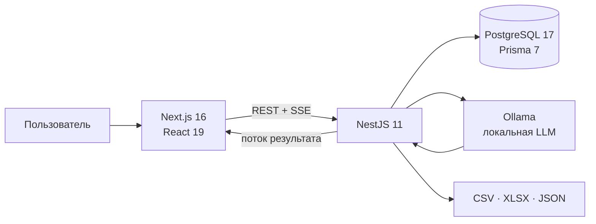

<div align="center">

# ProductAI

### Локальная AI-студия контента для интернет-магазинов

Создавайте описания, SEO-заголовки, meta description и ключевые слова  
для одного товара или целого каталога — без передачи данных во внешние AI-сервисы.

[](https://nextjs.org/)
[](https://nestjs.com/)
[](https://www.postgresql.org/)
[](https://www.prisma.io/)
[](https://ollama.com/)

[Возможности](#-возможности) · [Быстрый старт](#-быстрый-старт) · [Архитектура](#-архитектура) · [API](#-api)

</div>

---

## О проекте

ProductAI — полнофункциональное веб-приложение для подготовки контента карточек товаров. Модель запускается локально через Ollama, результаты сохраняются в PostgreSQL, а готовые тексты появляются в интерфейсе по мере генерации благодаря Server-Sent Events.

Проект подходит для локальной работы с каталогами, прототипирования AI-копирайтинга и автоматизации контент-команд.

## ✨ Возможности

- **Полный комплект контента:** основное и краткое описание, SEO title, meta description и ключевые слова.
- **5 стилей текста:** профессиональный, продающий, дружелюбный, премиальный и SEO.
- **Гибкая генерация:** русский и английский языки, три варианта длины и до трёх версий текста за один запрос.
- **Потоковый результат:** текст появляется в интерфейсе во время генерации; процесс можно отменить.
- **Каталог товаров:** сохранение, редактирование и повторное использование данных товара.
- **История:** просмотр и удаление предыдущих генераций, быстрое копирование результата.
- **Массовая обработка:** импорт CSV, XLSX или JSON, предпросмотр, автоматическое сопоставление колонок и экспорт результата в исходном формате.
- **Локальная AI-модель:** контент создаётся через Ollama без обязательного облачного API.
- **Адаптивный интерфейс:** рабочая панель оптимизирована для компьютеров и мобильных устройств.

## 🧭 Как это работает



## 🧰 Стек

| Слой | Технологии |
|---|---|
| Frontend | Next.js 16, React 19, TypeScript, Tailwind CSS 4, TanStack Query, React Hook Form, Zod |
| Backend | NestJS 11, TypeScript, class-validator, Server-Sent Events |
| Данные | PostgreSQL 17, Prisma 7 |
| AI | Ollama, настраиваемая локальная модель |
| Файлы | ExcelJS, csv-parse, csv-stringify |
| Инфраструктура | Docker Compose |

## 🚀 Быстрый старт

### Требования

- Node.js **22.18+** и npm;
- Docker с Docker Compose;
- [Ollama](https://ollama.com/download).

### 1. Подготовьте проект

```bash
git clone <repository-url>
cd create-text
```

Установите зависимости отдельно для API и клиента:

```bash
cd api && npm install
cd ../client && npm install
cd ..
```

### 2. Запустите PostgreSQL

```bash
docker compose up -d postgres
```

База будет доступна на `localhost:5432` с именем `product_ai`.

### 3. Подготовьте Ollama

Запустите сервис и загрузите модель. По умолчанию интерфейс проекта рассчитан на `qwen2.5:3b`, но можно указать любую совместимую модель.

```bash
ollama serve
```

В другом терминале:

```bash
ollama pull qwen2.5:3b
```

### 4. Настройте API

Создайте файл `api/.env`:

```dotenv
DATABASE_URL="postgresql://<DB_USER>:<DB_PASSWORD>@localhost:5432/<DB_NAME>?schema=public"
OLLAMA_HOST="http://localhost:11434"
OLLAMA_MODEL="qwen2.5:3b"
PORT=4000
```

> Значения в угловых скобках — плейсхолдеры. Подставьте собственные данные PostgreSQL и не коммитьте файл `.env`. Параметры подключения должны совпадать с настройками базы в `docker-compose.yml`.

Примените миграции и сгенерируйте Prisma Client:

```bash
cd api
npm exec prisma migrate deploy
npm exec prisma generate
npm run start:dev
```

API запустится на [http://localhost:4000](http://localhost:4000).

### 5. Запустите клиент

В новом терминале:

```bash
cd client
npm run dev
```

Откройте [http://localhost:3000](http://localhost:3000).

> Клиент по умолчанию обращается к `http://localhost:4000`. Для другого адреса создайте `client/.env.local` и задайте `NEXT_PUBLIC_API_URL`.

## ⚙️ Переменные окружения

### API — `api/.env`

| Переменная | Обязательна | Пример | Назначение |
|---|:---:|---|---|
| `DATABASE_URL` | да | `postgresql://<user>:<password>@localhost:5432/<database>?schema=public` | Подключение к PostgreSQL; содержит секреты |
| `OLLAMA_HOST` | да | `http://localhost:11434` | Адрес Ollama API |
| `OLLAMA_MODEL` | да | `qwen2.5:3b` | Модель для генерации |
| `PORT` | нет | `4000` | Порт API; без переменной используется `3000` |

### Client — `client/.env.local`

| Переменная | Обязательна | Значение по умолчанию |
|---|:---:|---|
| `NEXT_PUBLIC_API_URL` | нет | `http://localhost:4000` |

## 📁 Структура проекта

```text
create-text/
├── api/                       # NestJS API
│   ├── prisma/                # схема и миграции базы данных
│   └── src/
│       ├── bulk-generations/  # импорт, очередь и экспорт каталогов
│       ├── generations/       # обычная и потоковая генерация
│       ├── products/          # каталог товаров
│       └── prisma/            # подключение к PostgreSQL
├── client/                    # Next.js-приложение
│   └── src/
│       ├── app/               # страницы App Router
│       ├── entities/          # API-клиенты сущностей
│       ├── features/          # пользовательские сценарии
│       └── shared/            # общие типы, UI и инфраструктура
└── docker-compose.yml         # локальный PostgreSQL
```

## 🔌 API

Базовый адрес при рекомендуемой конфигурации: `http://localhost:4000`.

| Метод | Маршрут | Назначение |
|---|---|---|
| `POST` | `/generations` | Создать одну или несколько генераций |
| `POST` | `/generations/stream` | Потоковая генерация через SSE |
| `GET` | `/generations` | Получить историю генераций |
| `GET` | `/generations/:id` | Получить генерацию |
| `DELETE` | `/generations/:id` | Удалить генерацию |
| `GET` | `/products` | Получить товары |
| `GET` | `/products/:id` | Получить товар и его генерации |
| `PATCH` | `/products/:id` | Обновить товар |
| `DELETE` | `/products/:id` | Удалить товар |
| `POST` | `/bulk-generations` | Загрузить CSV, XLSX или JSON до 10 МБ |
| `GET` | `/bulk-generations/:id/preview` | Предпросмотр и сопоставление колонок |
| `POST` | `/bulk-generations/:id/start` | Запустить пакетную обработку |
| `POST` | `/bulk-generations/:id/cancel` | Отменить задачу |
| `GET` | `/bulk-generations/:id/download` | Скачать готовый результат |

<details>
<summary><strong>Пример потоковой генерации</strong></summary>

```bash
curl -N http://localhost:4000/generations/stream \
  -H 'Content-Type: application/json' \
  -d '{
    "productName": "Термокружка Nord",
    "brand": "Nord",
    "category": "Посуда",
    "features": ["объём 450 мл", "нержавеющая сталь", "герметичная крышка"],
    "targetAudience": "путешественники и офисные сотрудники",
    "tone": "professional",
    "language": "ru",
    "length": "medium",
    "variants": 1
  }'
```

</details>

## 📦 Массовая генерация

1. Перейдите в **Генерация → Массовая генерация**.
2. Загрузите CSV, XLSX или JSON размером до 10 МБ и не более 1000 строк.
3. Проверьте автоматически найденные колонки и обязательно сопоставьте название товара.
4. Выберите стиль, язык, длину и количество вариантов.
5. Запустите обработку и скачайте дополненный файл после завершения.

Для CSV поддерживаются разделители `,` и `;`. В XLSX можно выбрать нужный лист. Колонка с характеристиками может содержать значения, разделённые `|`, `;` или переносом строки.

## 🧪 Команды разработчика

```bash
# Client
cd client
npm run lint
npm run build
npm run format

# API
cd api
npm run lint
npm run format:check
npm run test
npm run build
```

## 🛠 Возможные проблемы

<details>
<summary><strong>API не подключается к Ollama</strong></summary>

Проверьте, что `ollama serve` запущен, `OLLAMA_HOST` указывает на `http://localhost:11434`, а модель из `OLLAMA_MODEL` доступна в выводе `ollama list`.

</details>

<details>
<summary><strong>Порт 3000 уже занят</strong></summary>

Backend без переменной `PORT` тоже использует порт `3000`. Укажите `PORT=4000` в `api/.env`, как в примере выше.

</details>

<details>
<summary><strong>Prisma не видит базу данных</strong></summary>

Убедитесь, что контейнер запущен командой `docker compose ps`, а параметры `DATABASE_URL` совпадают с `docker-compose.yml`.

</details>

## 📄 Лицензия

Лицензия проекта пока не указана. Перед публичным распространением добавьте файл `LICENSE` и обновите этот раздел.

---

<div align="center">

**ProductAI** — контент для карточек товаров, созданный локально.

</div>
